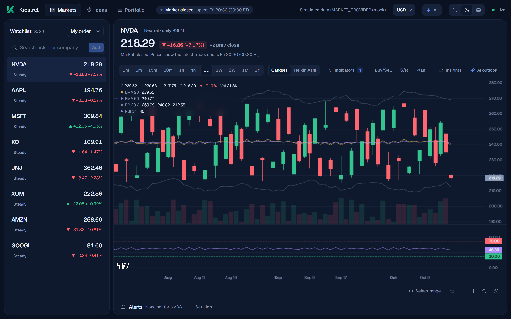
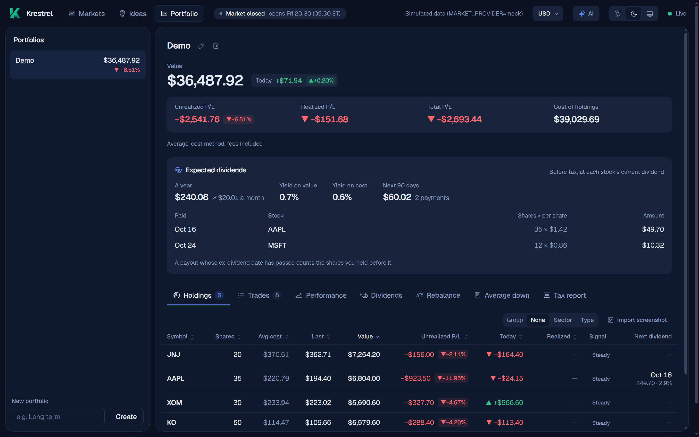
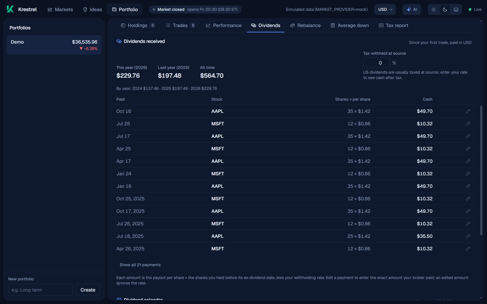
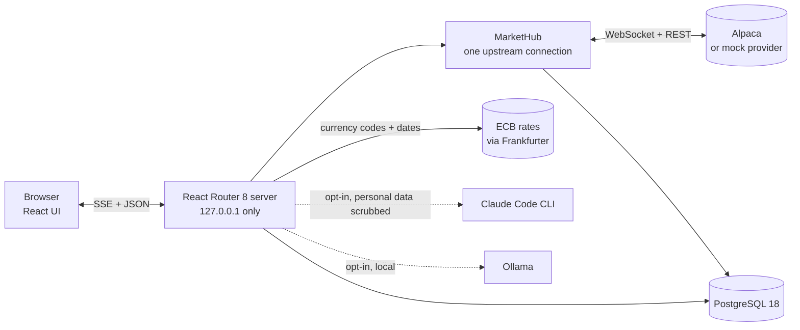

<div align="center">

<picture>
  <source media="(prefers-color-scheme: dark)" srcset="public/brand/krestrel-logo-on-dark.svg">
  
</picture>

**A self-hosted, real-time ticker for NYSE & Nasdaq.**<br>
Live prices, candlestick charts, portfolios and opt-in AI insight, all running on your own machine.


[](LICENSE)
[](https://github.com/Solutionist/Krestrel/actions/workflows/ci.yml)
[](https://github.com/Solutionist/Krestrel/actions/workflows/codeql.yml)


[Features](#features) · [Screenshots](#screenshots) · [Quick start](#quick-start) · [Architecture](#architecture) · [Configuration](#configuration) · [License](#license)

</div>



<div align="center"><sub>Simulated data from the built-in mock provider.</sub></div>

> [!IMPORTANT]
> The code is MIT-licensed. Market data you stream with your own Alpaca keys is for personal, non-professional use under Alpaca's terms, so Krestrel binds to 127.0.0.1, has no accounts, sharing or hosting features, and never places orders.

---

## Contents

- [Features](#features)
- [Screenshots](#screenshots)
- [Quick start](#quick-start)
- [Optional extras](#optional-extras)
- [Architecture](#architecture)
- [Tech stack](#tech-stack)
- [Configuration](#configuration)
- [Commands](#commands)
- [Testing](#testing)
- [Project structure](#project-structure)
- [Security & privacy](#security--privacy)
- [Troubleshooting](#troubleshooting)
- [Contributing](#contributing)
- [Project docs](#project-docs)
- [Acknowledgements](#acknowledgements)
- [Disclaimer](#disclaimer)
- [License](#license)

## Features

### 📈 Markets

- **Watchlist**: up to 30 symbols (the Alpaca free-plan streaming limit), with search by ticker or company name. Every symbol is checked against active NYSE/Nasdaq listings. Sort by your own order, symbol, price or change.
- **Live prices**: change vs. previous close (▲/▼ plus colour), a flash on each update, and a connection indicator.
- **Charts**: intervals 1m · 5m · 15m · 30m · 1h · 4h · 1D · 1W · 2W · 1M · 1Y, with up to 10 years of daily history. Switch between **Candles** and **Heikin Ashi** bars (the numbers shown always stay real prices). Zoom, pan, and **Select range** (Shift+drag) to measure any period.
- **Indicators**: EMA 20/50/100, Bollinger Bands (20, 2), and RSI 14 with overbought/oversold zones and Buy/Sell markers.
- **Hindsight analysis**: best past swing trades, support/resistance levels, a trend line, and a rule-based plan (buy zone, stop, targets), all computed locally.
- **Dividends**: for stocks that pay, a line under the chart shows how often they pay, the amount per share and yield, and the next ex-dividend and pay dates (announced, or "expected" from the usual schedule).
- **Price alerts**: set "above" or "below" a price for any watchlist stock from under the chart. Alerts show as lines on the chart and a bell in the watchlist. When the price reaches one, you get a notice in the app (and a browser notification if you allow it), and the alert switches off. Alerts are checked while Krestrel is running.
- **Market status**: open, closed, pre-market or after hours.

### 💼 Portfolio

- **Named portfolios** of buys and sells: fractional shares, fees, live value, and unrealized/realized/today's P/L (average-cost method). Sells of more shares than you held are refused.
- **Tabs**: Holdings · Trades · Performance · Dividends · Rebalance · Average down · Tax report, so each tool has its own space.
- **Sortable holdings**: click any column header (▲/▼). A **Next dividend** column shows each stock's next pay date, the cash it brings for your shares, and its yearly yield at the last price.
- **Expected dividends**: yearly income (and per month), yield on value and on cost (over holdings with a live price, like the totals), and every payment due in the next 90 days. A payout whose ex-dividend date has passed counts only the shares you held before it. Yearly payers are recognised from about 28 months of history.
- **Import from a screenshot**: paste (Ctrl+V) a broker screen such as Dime. The AI reads ticker, shares and average cost; you review and edit, then import. With a local model the image never leaves your machine; with Claude it is masked first (see below).
- **Group holdings** by sector or by type (Growth · Dividend · Risky), with each group's value and share. The AI classifies each stock once; correct any of them from the row's menu, and your choice sticks.
- **Performance**: the portfolio's value over time against SPY, as if the same buys and sells had gone into SPY on the same days. Time-weighted return for 1M · 3M · YTD · 1Y · All (price only; dividends not included).
- **Dividends received**: every payout you were entitled to since your first trade, worked out from the provider's payments and the shares you held before each ex-dividend date. Totals for this year, last year and all time. Set the tax withheld at source to see cash after tax, or enter the exact amount your broker paid for any payment (it sticks).
- **Dividend calendar**: the next 12 months of expected payments for what you hold, month by month.
- **Rebalance**: set a target % per stock and see what to buy (and, if you choose, sell) to reach it, with optional new cash to add. Suggestions only; Krestrel never places orders.
- **Average-down calculator**: e.g. 50 @ $150, buy at $80, target $120 → 37.5 shares ($3,000).
- **Tax report**: realized P/L and dividends per year in your display currency, each amount converted at its own date's ECB rate (average-cost method, fees included), with a per-sell breakdown and a CSV download. For your records, not tax advice.
- **Display currency**: THB and ~30 others at the European Central Bank's daily rate (only currency codes are sent, plus a start date for the tax report's past rates).

### 🤖 AI (opt-in)

- **AI outlook**: reads recent news, the analyst consensus and price targets, then suggests buy, exit and take-profit levels with sources.
- **Stock ideas**: 5–10 growth, dividend and risky picks steered by your portfolio's sector mix, each with its dividend schedule when it pays one. Only tickers and percentage weights are sent.
- **RSI signals**: a daily Oversold / Buy / Sell / Overbought signal for every watchlist stock and holding (computed locally, no AI).

Each AI feature runs on **your own** Claude Code subscription or on a free local model, your choice per feature (see [Optional extras](#optional-extras)). None of it is financial advice.

### ⚙️ Under the hood

- Light and dark navy themes (follows your system), Geist type.
- Live 1-minute bars are recorded, and full-market history is backfilled automatically.
- Pluggable data providers: Alpaca, or a simulated `mock` provider for offline use.

> [!NOTE]
> On Alpaca's free plan, live data comes from the IEX exchange only (partial volume), and the UI says so. Complete-market history is available once it is at least 15 minutes old.

## Screenshots

<table>
  <tr>
    <td width="50%"></td>
    <td width="50%"></td>
  </tr>
  <tr>
    <td align="center">Holdings with live P/L and next dividends</td>
    <td align="center">Dividends received, worked out from your trades</td>
  </tr>
</table>

<sub>All screenshots show simulated data from `MARKET_PROVIDER=mock`.</sub>

## Quick start

**Requirements:** Node.js 24 LTS (`.nvmrc`) · [Bun](https://bun.sh) 1.4+ (installs packages and runs scripts) · Docker (PostgreSQL 18) · a free [Alpaca](https://alpaca.markets) account (paper keys work), or the mock provider.

```bash
git clone https://github.com/Solutionist/Krestrel.git && cd Krestrel
bun install
cp .env.example .env          # fill in ALPACA_KEY_ID and ALPACA_SECRET_KEY
bun run db:up                 # Postgres on 127.0.0.1:5432
bun run dev                   # → http://127.0.0.1:5173
```

Migrations run automatically on startup. Add a symbol in the sidebar to start streaming.

> [!TIP]
> **No Alpaca keys?** Set `MARKET_PROVIDER=mock` in `.env` for simulated, deterministic market data.

<details>
<summary><b>Run the full stack in Docker</b></summary>

```bash
cp .env.example .env          # fill in keys or set MARKET_PROVIDER=mock
docker compose up -d --build --wait
```

Open http://127.0.0.1:3000. Ports are published on `127.0.0.1` only. Screenshot import and the AI features need tools on the host, so they aren't available inside the container.

</details>

## Optional extras

Every AI feature (AI outlook, stock ideas, screenshot import, holding groups) can use Claude or a model on your own computer. Pick a default and per-feature models in the app's **AI** menu (top bar).

| Option | Needs | Setup |
|---|---|---|
| Claude | [Claude Code](https://claude.com/code) + a Claude subscription | Run `claude` once and `/login` |
| Local models | [Ollama](https://ollama.com) | Keep Ollama running, then click Download in the AI menu. Large `qwen3.8:27b` needs a 24 GB GPU; Medium `qwen3-vl:8b-instruct` and Small `qwen3-vl:4b-instruct` run on far less |
| Web search for local models | A [Tavily](https://tavily.com) API key | Set `TAVILY_API_KEY` in `.env`. Only search queries are sent |

## Architecture



- **One upstream connection.** A single `MarketHub` owns the provider's stream; every browser tab shares it, because the free Alpaca plan allows only one ([ADR 0004](ai/decisions/0004-single-upstream-connection.md)).
- **SSE fan-out.** The server pushes ticks, bars and alerts to tabs over Server-Sent Events; writes go through JSON resource routes ([ADR 0002](ai/decisions/0002-sse-over-websockets.md)).
- **Bars stored per source**, so IEX live bars and full-market history never mix; missing intraday and daily history is backfilled automatically ([ADR 0005](ai/decisions/0005-bars-by-source.md), [ADR 0011](ai/decisions/0011-daily-history-for-long-intervals.md)).
- **Migrations at boot.** The server applies Drizzle migrations before it serves anything.
- **Loopback only**, with a request guard on every request ([ADR 0007](ai/decisions/0007-loopback-only.md); see [Security & privacy](#security--privacy)).

More detail: [`ai/architecture.md`](ai/architecture.md) and the decision records in [`ai/decisions/`](ai/decisions/).

## Tech stack

| Area | Tools |
|---|---|
| UI | React 19, React Router 8 (SSR), Tailwind CSS 4, Lightweight Charts 5, Phosphor Icons, Geist |
| Server | Node 24, Server-Sent Events, Zod 4, pino |
| Data | PostgreSQL 18, Drizzle ORM, postgres.js |
| AI (opt-in) | Claude Code CLI, Ollama, Tavily |
| Tooling | TypeScript 7 strict, Vite 8, Vitest 5 + Testing Library, Biome 2, Bun |

## Configuration

Settings live in `.env` (copy [`.env.example`](.env.example)). Invalid or missing values stop the server at startup with a message naming each variable.

<details>
<summary><b>All variables</b></summary>

| Variable | Default | Purpose |
|---|---|---|
| `DATABASE_URL` | — (required; `.env.example` has the local one) | Postgres for host runs (compose overrides it) |
| `MARKET_PROVIDER` | `alpaca` | `alpaca` or `mock` |
| `BACKFILL_DAYS` | `30` | Days of 1-minute history per symbol (intraday intervals), 0–365 |
| `DAILY_HISTORY_YEARS` | `10` | Years of daily history per symbol (1D–1Y intervals), 0–30 |
| `LOG_LEVEL` | `info` | `trace` … `fatal`, `silent` |
| `ALPACA_KEY_ID`, `ALPACA_SECRET_KEY` | — | Required for `alpaca` |
| `ALPACA_STREAM_FEED` | `iex` | `iex` (free) or `sip` (paid) |
| `ALPACA_TRADING_URL` | `https://paper-api.alpaca.markets` | Clock and asset lookup. Use `https://api.alpaca.markets` with live-account keys. A trailing `/v2` is fine |
| `ALPACA_DATA_URL`, `ALPACA_STREAM_URL` | `https://data.alpaca.markets`, `wss://stream.data.alpaca.markets/v2` | Endpoint overrides, rarely needed. The stream URL must be `wss://` |
| `LLM_PROVIDER` | `claude-cli` | `claude-cli` or `none` |
| `CLAUDE_CLI_PATH`, `CLAUDE_MODEL` | `claude`, CLI default | CLI location and the model for "Claude (default)" |
| `CLAUDE_TIMEOUT_MS` | `180000` | 10000–600000. Wait for a Claude call without its own budget (holding groups). The outlook, stock ideas and screenshot import always allow 300000 (5 min) |
| `OLLAMA_URL`, `OLLAMA_MODEL` | `http://127.0.0.1:11434`, `qwen3-vl:8b-instruct` | Local Ollama and the model used for "Local default". Loopback URLs only |
| `TAVILY_API_KEY` | — | Optional. Web search for local models (outlook, ideas) |
| `TAVILY_URL` | `https://api.tavily.com` | Tavily endpoint (https only) |
| `MOCK_SEED`, `MOCK_TICK_MS` | `42`, `1000` | Mock provider seed and tick interval (≥ 50) |
| `HOST`, `PORT` | `127.0.0.1`, `3000` | `bun run start` sets 127.0.0.1 / 3000; the Docker image uses 0.0.0.0 inside the container |
| `POSTGRES_*`, `APP_PORT` | see `.env.example` | Docker Compose settings |
| `TEST_DATABASE_URL` | `DATABASE_URL` + `_test` | Database for the DB tests |

</details>

## Commands

| Command | What it does |
|---|---|
| `bun run dev` | Dev server on 127.0.0.1:5173 |
| `bun run build` | Production build |
| `bun run start` | Serve the build on http://127.0.0.1:3000 |
| `bun run typecheck` · `lint` · `format` | Types · Biome lint · Biome format |
| `bun run test` | Unit, component and DB tests (needs `db:up`). Use this, not `bun test` |
| `bun run db:up` · `db:down` | Start · stop Postgres |
| `bun run db:generate` · `db:migrate` · `db:studio` | Drizzle migrations and studio |

## Testing

`bun run test` runs three Vitest projects (never bare `bun test`, which is Bun's own runner):

| Project | Environment | Files |
|---|---|---|
| `unit` | Node | `app/**/*.test.ts` |
| `dom` | jsdom + Testing Library | `app/**/*.test.tsx` |
| `db` | Real PostgreSQL | Database queries, market hub, alerts, backfill and daily closes |

DB tests create and use a separate `<db>_test` database (`TEST_DATABASE_URL`), so start Postgres first with `bun run db:up`. Recorded provider responses live in `tests/fixtures`. Unit tests sit next to the code they cover.

## Project structure

```text
app/routes/        Pages and api.* resource routes (SSE, JSON)
app/.server/       Server-only code: env, logger, database, market data, AI
app/lib/           Isomorphic types, Zod schemas, formatters and calculations
app/components/    React components (chart, watchlist, portfolio, UI)
app/hooks/         React hooks (theme, stored settings, clock)
drizzle/           SQL migrations, applied at boot
tests/             Test setup and recorded fixtures
ai/                Guidelines and architecture decision records
public/brand/      Logo and icons
docs/images/       README screenshots
```

## Security & privacy

- **Loopback only.** Servers bind to `127.0.0.1`; Docker publishes ports on `127.0.0.1` only.
- **Request guard.** A request whose `Host` isn't `127.0.0.1`, `localhost` or `[::1]` gets `421`, which blocks DNS rebinding. Any cross-site request to `/api/*`, whatever the method, gets `403`. Pages send `X-Frame-Options: DENY` and `frame-ancestors 'none'`.
- **Secrets** stay in the git-ignored `.env` and are redacted from logs.
- **Outbound data** is limited: exchange rates send only currency codes and a start date, and AI features are opt-in per feature.

**Privacy with Claude:** every prompt is scrubbed of emails, phone numbers, card and account numbers before it leaves, and Claude Code runs without your personal `CLAUDE.md` files. A screenshot sent to Claude is first masked on your computer: only holdings rows and column headers stay visible, and lines carrying a personal-field label (phone, ID, SSN, date of birth…, in any case) are blacked out with everything else. You approve the masked copy before it goes, and it always goes to the Claude model it was prepared for. Local models skip all of this because nothing leaves your machine.

Found a vulnerability? Report it privately via [GitHub security advisories](https://github.com/Solutionist/Krestrel/security/advisories/new), not in a public issue.

## Troubleshooting

<details>
<summary><b>Startup & data</b></summary>

| Symptom | Fix |
|---|---|
| "Invalid environment configuration" | Fix the listed variables; compare with `.env.example` |
| "server startup failed (is Postgres running?)" | `bun run db:up` |
| "Alpaca rejected the API keys" | Check the keys; paper keys need the paper `ALPACA_TRADING_URL`, live keys the live one |
| "Another app is already using your Alpaca stream" (406) | The free plan allows one stream connection. Close the other app or the second Krestrel (e.g. `dev` and Docker together); it retries every minute |
| Market status "unknown" or symbols can't be added | Trading API unreachable, or the wrong `ALPACA_TRADING_URL` for your keys |
| "Port 5173 is already in use" | Another dev server is running; Krestrel won't start a second one, so it never opens a second upstream connection |
| Only USD in the currency menu | Exchange rates couldn't load; check the server log for `exchange rate refresh failed`, then restart `bun run dev` |
| Code change to the market hub not picked up | Restart `bun run dev` (the hub survives hot reload on purpose) |
| Random "connect ETIMEDOUT 127.0.0.1:5432" or "database does not exist" right after `createdb` | Docker Postgres networking hiccup on Windows; reload, or restart Docker Desktop if it keeps happening |

</details>

<details>
<summary><b>AI & screenshot import</b></summary>

| Symptom | Fix |
|---|---|
| "Claude Code isn't signed in" | Run `claude` in a terminal and `/login` |
| "Claude Code isn't installed here" | Install Claude Code, or set `CLAUDE_CLI_PATH`. On Windows, Krestrel finds `claude.exe` via PATH or npm's `claude.cmd`; otherwise point `CLAUDE_CLI_PATH` at `claude.exe` |
| "… needs Ollama running" / "isn't downloaded yet" (a feature set to a local model) | Install Ollama and keep it running, then click Download in the AI menu (or `ollama pull <model>`). Reopening the AI menu rechecks Ollama, so no page reload is needed. The first request after a break loads the model (~1–2 min) |
| Outlook or ideas say "No web research" | The feature uses a local model without `TAVILY_API_KEY`; add a key, or pick Claude for it |
| Dividends show "…" or "Dividend data is unavailable" | Alpaca's corporate-actions data couldn't be reached; reload later (results are cached for 6 hours) |

</details>

## Contributing

Issues and pull requests are welcome. Use the bug or feature issue forms and fill in the pull request checklist. Before opening a PR, run `bun run typecheck && bun run lint && bun run test` (CI runs the same checks plus a build, and CodeQL and CodeRabbit review every pull request), and read [`CLAUDE.md`](CLAUDE.md) and [`ai/`](ai/README.md) for conventions. Krestrel stays personal, single-user and loopback-only: trading, accounts or auth, multi-user and public hosting are out of scope.

## Project docs

[`CLAUDE.md`](CLAUDE.md) is the entry point for contributors and AI agents. Detailed guidelines and decision records live in [`ai/`](ai/README.md). Brand assets are in [`public/brand/`](public/brand). Release notes are in [`CHANGELOG.md`](CHANGELOG.md) (current release: **1.0.0**).

## Acknowledgements

- [TradingView Lightweight Charts™](https://www.tradingview.com/) (Apache-2.0); its attribution logo shows on the charts.
- [Alpaca](https://alpaca.markets) market data.
- ECB reference rates via [Frankfurter](https://frankfurter.dev).
- [Geist](https://vercel.com/font) (SIL OFL 1.1).
- [Phosphor Icons](https://phosphoricons.com) (MIT).
- [Tesseract.js](https://tesseract.projectnaptha.com) (Apache-2.0) for on-device OCR.
- [React Router](https://reactrouter.com), [Drizzle ORM](https://orm.drizzle.team), [Zod](https://zod.dev) and [pino](https://getpino.io).

## Disclaimer

Not financial advice. Not affiliated with Alpaca, TradingView, Anthropic or the ECB. Free-plan live data is IEX-only and may be incomplete.

## License

MIT © 2026 Solutionist. See [LICENSE](LICENSE).
